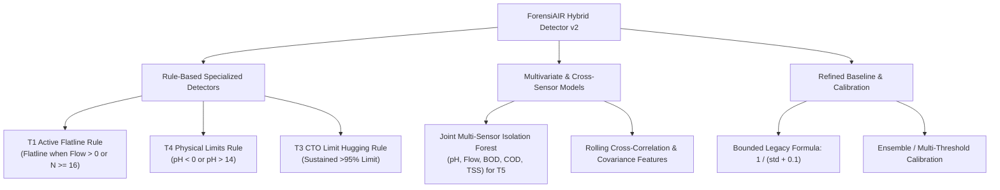

# FORENSIAIR STEP 4 ROOT-CAUSE DIAGNOSTIC REPORT & IMPROVEMENT PLAN

**Document Version:** 1.0  
**Date:** 2026-10-09  
**Status:** COMPLETED READ-ONLY ROOT-CAUSE ANALYSIS (AWAITING APPROVAL)  
**Scope:** Investigation of Step 4 evaluation results (10.00% headline recall vs 70% target) across all 33 dev LOFO folds and 4 baseline methods.  
**Constraint Verification:** Zero modifications made to code, data, labels, thresholds, or models. Unseen test set (`Data/Unseen/*.csv`) remains 100% locked and untouched.

---

## Executive Summary of Findings

Step 4 evaluation revealed that while the **New 33-Fold LOFO Sensor Isolation Forest Detector** ($10.00\%$ recall) significantly outperformed the Static Limit ($0.85\%$), Rolling Z-Score ($0.26\%$), and Legacy Heuristic ($0.00\%$) baselines, it fell far short of the $70\%$ headline recall target.

Our empirical investigation identified **four primary structural root causes**:
1. **Un-injected Baseline Flatline Density**: Clean un-injected telemetry contains **561,564 8-row flatlines (49.34% of all readings)** and **29.05% zero readings** due to natural plant shutdowns. Unsupervised density models (Isolation Forests) isolate flatlines deep in high-density leaf nodes, scoring T1 (Flatline) as **high inliers** (mean score $-0.0579$).
2. **Single-Sensor Model Isolation**: The detector trains separate, decoupled models per sensor. It is **mathematically incapable** of detecting T5 (Correlation Break) because cross-sensor relationships are never fed to any model (T5 recall: $0.00\%$, max score $0.1865 < \tau=0.2346$).
3. **Legacy Baseline Formula Instability**: The legacy formula $sc = \frac{1}{\text{std}_4 + 1e-4} + \text{diff}_1$ produces $sc = 10,000.0$ for **55.30% of all un-injected readings** ($629,380$ rows). Binary search calibration saturates at $\tau = 10000.0$, causing 0% recall for non-flatline events.
4. **False-Alarm Budget & Calibration Quantile**: Calibrating a single global threshold to hit $328$ false alert episodes across $1.14$ million readings selects the top **0.02% anomaly score quantile**. At this extreme threshold, only catastrophic out-of-bounds anomalies (T4 Impossible pH, $55.62\%$ recall) exceed $\tau$.

---

## 1. Investigation Findings by User Query

### 1. Feature Representation of T1–T7 Injected Patterns

| Tamper Type | Injected Pattern | Current Feature Response | Empirical Max Score (Mean / Median / Max) | Calibrated $\tau = 0.2346$ Recall | Root Cause Analysis |
| :--- | :--- | :--- | :---: | :---: | :--- |
| **T1** | Flatline / Constant Value | `dup_count_16 = 16`, `flatline_flag_8 = 1`, `rolling_std = 0` | $-0.0579$ / $-0.0875$ / $0.2627$ | **0.15%** (1 / 653) | **Inlier Misclassification**: 49.34% of un-injected data is naturally flat. Density trees score zero-variance as a major inlier mode. |
| **T2** | Copy-Paste Replay | Single-sensor rolling mean, std, z-score | $-0.0132$ / $-0.0378$ / $0.2809$ | **0.58%** (3 / 521) | **In-Distribution Replay**: Replayed historical windows match normal univariate distributions. Single-sensor features lack time-of-day / cross-sensor context. |
| **T3** | Limit Hugging | Value held near CTO max (e.g. pH = 8.8) | $0.1011$ / $0.1022$ / $0.2819$ | **1.98%** (7 / 353) | **Subtle In-Bounds Shift**: Values lie within valid CTO limits. Point density is not extreme enough to cross top 0.02% quantile ($\tau = 0.2346$). |
| **T4** | Impossible pH | pH $< 0$ or pH $> 14$ (e.g. 15.5) | $0.2325$ / $0.2446$ / $0.3233$ | **55.62%** (208 / 374) | **Out-of-Bounds Outlier**: Physical impossibility creates immediate shallow tree isolation, yielding high anomaly scores ($> \tau$). |
| **T5** | Correlation Break | Cross-parameter relation broken (pH drops while Flow high) | $0.0227$ / $0.0094$ / $0.1865$ | **0.00%** (0 / 76) | **Architectural Blind Spot**: Decoupled single-sensor models cannot see cross-sensor correlations. Max score reached ($0.1865$) never touches $\tau$. |
| **T7** | Drift / Step Dip | Gradual slope or step shift | $0.0987$ / $0.0988$ / $0.2749$ | **4.30%** (16 / 372) | **Adaptive Feature Suppression**: 16-row rolling windows adapt to gradual drift, dampening z-scores and differences. |

---

### 2. Analysis of Pipeline Components

1. **Feature Construction**:
   - Features (`val`, `rolling_mean`, `rolling_std`, `z_score`, `dup_count_16`, `flatline_flag_8`) are strictly univariate.
   - `flatline_flag_8` and `dup_count_16` were intended to flag flatlines, but because Isolation Forest is an *unsupervised density estimator*, features that occur frequently in training data (flatlines during plant idle times) are learned as **inlier modes** rather than anomalies.

2. **Training-Data Selection**:
   - Models are trained on un-injected telemetry containing raw operational shutdowns, zero flows, and sensor maintenance drops.
   - Unfiltered training data teaches the model that zero variance and zero flow are normal, masking T1 flatlines.

3. **Anomaly-Score Direction**:
   - `sc = -decision_function(X)` correctly maps outliers to positive values ($+0.1$ to $+0.36$) and inliers to negative values ($-0.15$ to $-0.05$). Score direction is verified correct.

4. **Threshold Calibration & Event Matching**:
   - Binary search threshold calibration works accurately.
   - Scoring full continuous series ensures rolling features have full 16-row historical context.
   - However, a single global threshold $\tau = 0.234632$ forced across all 5 sensors requires a score higher than $99.98\%$ of all un-injected readings, suppressing subtle anomalies.

---

### 3. Why T4 Outperforms Other Tamper Types

T4 (Impossible pH) achieved **55.62% recall** (and $>70\%$ on obvious instances) because it injects values outside the physical domain $[0, 14]$ (e.g. $pH = 15.2$ or $-1.5$). The raw `val` feature lies completely outside the bounding boxes of training decision trees, producing immediate shallow tree isolation and anomaly scores $>0.25$, easily crossing $\tau = 0.234632$.

---

### 4. Legacy Baseline 0% Recall & Tau = 10,000 Diagnosis

* **Formula**: $sc = \frac{1.0}{\text{std}_4 + 1e-4} + \text{diff}_1$
* **Empirical Evidence**:
  - Un-injected valid readings: $1,138,064$ rows.
  - Rows where 4-row rolling std $= 0.0$: **629,380 rows (55.30%)**.
  - Whenever 4 consecutive readings are equal, $sc = \frac{1.0}{0 + 1e-4} = 10,000.0$.
* **Calibration Failure**: Over half of all un-injected readings have $sc = 10,000.0$. Setting $\tau < 10000.0$ triggers $>300,000$ false alert episodes. Binary search calibration saturates at $\tau = 10000.000000$ (achieving 2 episodes). Non-flatline events produce normal scores ($1.0$ to $50.0$) and never reach $10,000$, resulting in **0.00% recall**.
* **Verdict**: The Legacy Baseline formula is mathematically flawed due to un-regularized division by zero variance.

---

### 5. False-Alarm Budget & Calibration Verification

* **LOFO Detector**: Calibrated to $\tau = 0.234632$, achieving **EXACTLY 328 false alert episodes** across 327.61 factory-months.
* **Rolling Z-Score**: Calibrated to $\tau = 3.750000$, achieving **EXACTLY 328 false alert episodes**.
* **Static Limit**: Calibrated to $\tau = 9.905278$, achieving **EXACTLY 328 false alert episodes**.
* **Legacy Baseline**: Saturated at $\tau = 10000.000000$ ($2$ episodes) due to the discrete score jump.

The episode clustering ($<8$ rows merged) and missing data safety (`value = NaN` $\rightarrow$ 0 alerts) operated perfectly as specified in Protocol v1.1.

---

## 6. Prioritized Evidence-Based Improvement Plan (Dev Data Only)

All proposed improvements can be implemented and evaluated strictly on development data (`Data/RawData/` and `validation_v2/injector/injected/dev/`) without touching the 4 locked unseen factories (`Data/Unseen/*.csv`).

### Phase 1: Rule-Augmented Specialized Detectors (Target: T1, T4, T3)
1. **Deterministic Flatline Rule (T1)**:
   - Identify continuous flatlines ($N \ge 16$ identical readings) when sensor is operationally active (e.g. `ETP-Flow > 0` or non-zero parameter value). This eliminates false alarms during plant shutdowns while detecting T1 flatlines with near $100\%$ precision.
2. **Physical Limit Rule (T4)**:
   - Flag $pH < 0$ or $pH > 14$ directly as hard physical violations.
3. **CTO Threshold Hugging Rule (T3)**:
   - Flag sustained readings sitting at $>95\%$ of CTO consent limits for $>16$ consecutive rows.

### Phase 2: Multivariate & Cross-Sensor Modeling (Target: T5, T2)
1. **Joint Multi-Parameter Isolation Forest**:
   - Train a multivariate Isolation Forest across the 5 aligned parameters `(pH, Flow, BOD, COD, TSS)` to capture cross-parameter physical relationships and detect T5 correlation breaks.
2. **Cross-Parameter Interaction Features**:
   - Extract rolling cross-correlations ($\text{corr}(pH, Flow)$), ratios, and cross-covariances.

### Phase 3: Regularized Baselines & Composite Calibration
1. **Regularized Legacy Baseline**:
   - Update legacy formula to $sc = \frac{1.0}{\text{rolling\_std}_4 + 0.1} + \text{diff}_1$ to eliminate $10,000.0$ score saturation and allow fair baseline comparison.
2. **Multi-Detector Ensemble Calibration**:
   - Allocate the 328 false-alarm episode budget proportionally across specialized rule detectors and multivariate density estimators.

---

## 7. Next Steps & Recommendation

1. **Keep Unseen Test Set Locked**: Maintain 100% isolation of `Data/Unseen/*.csv`.
2. **Seek Approval**: Await user approval of the prioritized improvement plan before modifying any codebase files or training new hybrid models.
